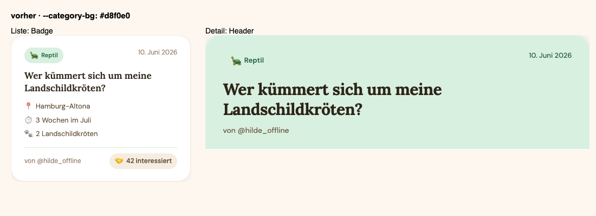
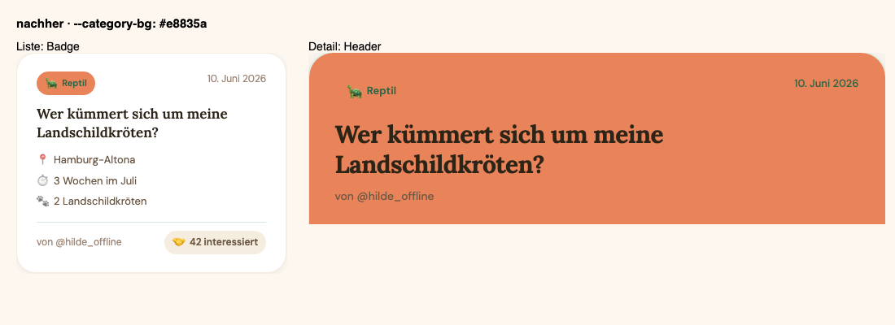

# 40: Screenshot-Vergleich mit toMatchScreenshot

## Ablauf

1. Test ausführen, das Referenzbild entsteht in `__screenshots__/…-chromium-darwin.png`.
2. In `styles.css` an `.category-reptil` die auskommentierte Zeile `--category-bg: #e8835a;` einschalten. Erzählen: gemeint war der Ton im Detail-Header, `--category-bg` färbt aber auch die Badge.
3. Test bricht. Im Fehler stehen Referenz, aktueller Screenshot und Diff-Bild. Ein Snapshot in jsdom bliebe grün, weil jsdom kein CSS rendert.
4. Farbe zurücksetzen.

Vorher und nachher in der App, oben die Liste mit der Badge, unten der Detail-Header:

| Vorher (`#d8f0e0`) | Nachher (`#e8835a`) |
|---|---|
|  |  |

## Fallstricke

- Locators treffen exakt. `getByText("Reptil")` findet die Badge nicht, weil sie „🐢 Reptil“ enthält. Deshalb steht im Test `getByText(/Reptil/)`.
- Failure-Screenshots liegen unter `.vitest/attachments/failure-screenshots/`, getrennt von den Referenzbildern in `__screenshots__`.
- Referenzbilder gibt es je Plattform. Für CI erzeugt `create-screenshot-baseline-images.sh` die Linux-Baseline im Playwright-Container.
